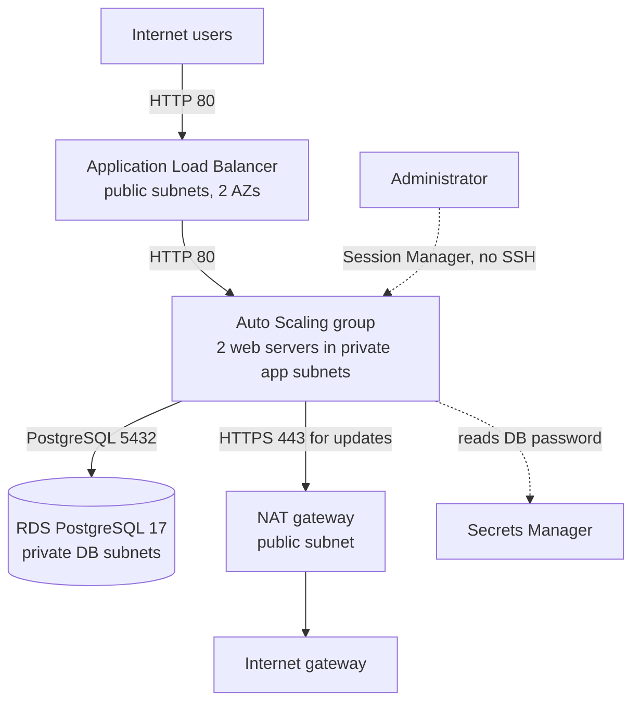

# Three-Tier Web Application on AWS with Terraform

A highly available web application on AWS, built entirely with Terraform. An internet-facing Application Load Balancer sends traffic to web servers in private subnets across two Availability Zones, managed by an Auto Scaling group, with a PostgreSQL database on Amazon RDS in its own private subnets. Servers are managed through AWS Systems Manager Session Manager, with no SSH keys and no open SSH port.

I wrote every resource myself from the Terraform Registry documentation, then deployed it, tested it (including a self-healing test), and destroyed it.

## Architecture



| Layer | Subnets | AZ a | AZ b | Route to the internet |
|---|---|---|---|---|
| Public (ALB, NAT) | `public_a`, `public_b` | 10.1.1.0/24 | 10.1.2.0/24 | internet gateway |
| App (web servers) | `app_a`, `app_b` | 10.1.11.0/24 | 10.1.12.0/24 | NAT gateway (outbound only) |
| Database (RDS) | `db_a`, `db_b` | 10.1.21.0/24 | 10.1.22.0/24 | none |

VPC: `10.1.0.0/16` in `eu-west-2` (London). Each tier has its own route table, and every subnet is explicitly associated, so nothing depends on the VPC's main route table.

## What it builds

| File | Resources |
|---|---|
| `provider.tf` | Terraform `~> 1.15`, AWS provider `~> 6.0`, region `eu-west-2` |
| `network.tf` | VPC, 6 subnets, internet gateway, 3 route tables, 6 route table associations |
| `security.tf` | 3 security groups (ALB, app, DB), 3 ingress rules, 3 egress rules |
| `nat.tf` | Elastic IP and NAT gateway (with `depends_on` the internet gateway) |
| `database.tf` | DB subnet group and RDS PostgreSQL 17 (`db.t4g.micro`, 20 GB gp3, encrypted) |
| `iam.tf` | EC2 role, `AmazonSSMManagedInstanceCore` attachment, instance profile, inline policy to read only the DB secret |
| `compute.tf` | latest Amazon Linux 2023 arm64 AMI (read from a public SSM parameter), launch template |
| `user_data.sh` | start-up script: installs and enables Apache, then writes a page showing the instance ID and AZ (using IMDSv2) |
| `alb.tf` | target group with health check, Application Load Balancer, HTTP listener, Auto Scaling group |
| `outputs.tf` | the load balancer's DNS name |

## Security decisions

- **Security group chain, one port per rule.** Internet → ALB on 80 · ALB → app on 80 · app → DB on 5432. The app and DB rules use security group references, not IP ranges. The DB has no outbound rules, because it only replies. Terraform removes AWS's default allow-all outbound rule, so every outbound rule is written explicitly.
- **Private servers and database.** Web servers have no public IP. The database has `publicly_accessible = false` and sits in subnets with no internet route.
- **No SSH.** No key pair and no port 22. Administration is through Session Manager, using the instance role.
- **No password in code.** `manage_master_user_password = true`: RDS generates the password and stores it in Secrets Manager. It never appears in Terraform code or state.
- **Least privilege.** The web servers may call only `secretsmanager:GetSecretValue`, and only on the database's own secret ARN (not `"*"`).
- **IMDSv2 required.** `http_tokens = "required"` and a hop limit of 1 on the launch template.
- **Encryption at rest** on the database (`storage_encrypted = true`).
- **Git hygiene.** `.gitignore` excludes the state files and `.terraform/`. `.gitattributes` forces LF line endings, so `user_data.sh` cannot break on Linux after a checkout on Windows.

## How I tested it

| Test | How | Result |
|---|---|---|
| Load balancing across AZs | opened the ALB DNS name and refreshed | the page switched between two instance IDs in `eu-west-2a` and `eu-west-2b` |
| Server health | Session Manager → `systemctl status httpd`, `curl -I http://localhost` | Apache enabled and running, `200 OK` |
| Start-up script | `sudo tail /var/log/cloud-init-output.log` | packages installed through the NAT gateway, finished in about 37 seconds |
| **Self-healing** | stopped Apache on one instance | the target went unhealthy, the site stayed up on the other AZ, and the ASG (ELB health checks) replaced the instance automatically |
| App → database network path | `bash` `/dev/tcp` test to the RDS endpoint on 5432 | port open |
| Least privilege | read the DB secret (name only), then a wrong secret ID | the DB secret was allowed; the other request got `AccessDenied` |

## Deploy and destroy

Prerequisites: Terraform 1.15+, AWS CLI v2 configured with an IAM user or role (not root).

```bash
cd terraform
terraform init
terraform plan      # expect: 39 to add
terraform apply
```

Wait 3–5 minutes after `apply`, then open the `alb_dns_name` output with `http://` in a browser.

```bash
terraform destroy   # expect: 39 to destroy
```

**Cost:** roughly 10–12p per hour while running (NAT gateway, ALB, RDS, two `t4g.micro` instances and public IPv4 addresses). I deploy it only for testing and destroy it the same day.

## Lab choices vs production

| In this lab | In production I would use |
|---|---|
| RDS Single-AZ | Multi-AZ, for automatic failover |
| One NAT gateway | one NAT gateway per AZ |
| HTTP only | HTTPS with an ACM certificate, and an 80 → 443 redirect |
| `skip_final_snapshot = true`, deletion protection off | a final snapshot, deletion protection, and `prevent_destroy` |
| Backups kept for 1 day | longer retention, based on the recovery requirements |
| Local Terraform state | remote state in S3 with locking |
| Applied from my laptop | a CI/CD pipeline with plan review and OIDC |

## What's next

- **Ansible:** configure and patch the web servers with playbooks
- **Version 2 of the app:** a page that reads from and writes to PostgreSQL
- **HTTPS:** an ACM certificate, a 443 listener and an 80 → 443 redirect
- **Remote state:** S3 backend with locking